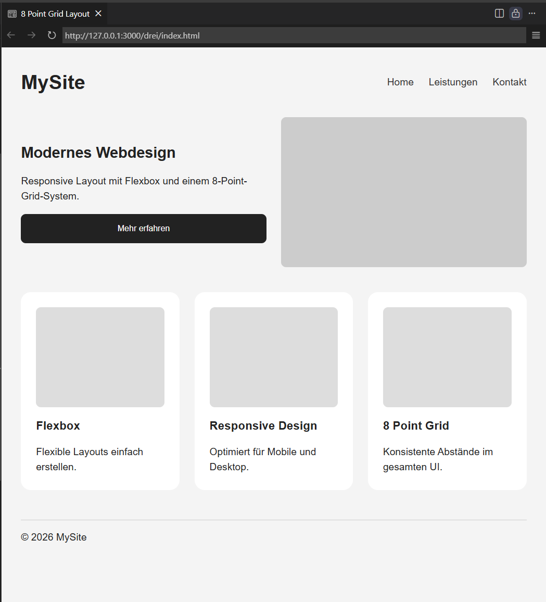
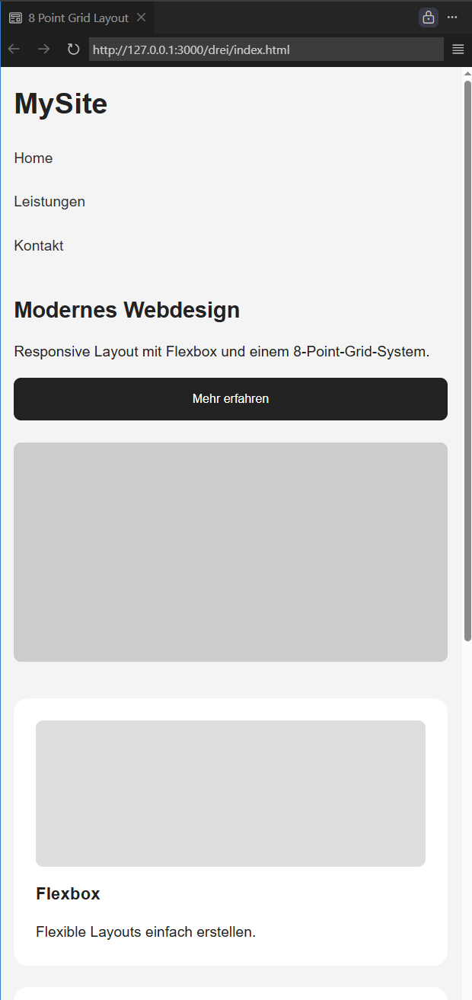

# Aufgabe: Responsive Contentseite mit 8-Point-Grid

Erstelle eine responsive Contentseite mit HTML und CSS, die:

- ein **8-Point-Grid-System** verwendet
- **Flexbox** nutzt
- mit **@media queries** zwischen Mobile und Desktop wechselt
- ausschließlich Abstände verwendet, die Vielfache von **8px** sind

---

### Desktop Ansicht



### Mobile Ansicht

## 

# Anforderungen

## Layout

Die Seite soll enthalten:

1. **Header**
   - Logo/Titel
   - Navigation

2. **Hero-Bereich**
   - Überschrift
   - kurzer Text
   - Button

3. **Content Cards**

   mindestens 3 Cards mit:
   - Bildplatzhalter
   - Titel
   - Beschreibung

4. **Footer**
   - Copyright Text

---

# Responsive Verhalten

## Mobile (< 768px)

- Navigation untereinander
- Cards untereinander
- Zentrierte Inhalte

## Desktop (≥ 768px)

- Navigation horizontal
- Hero-Inhalt nebeneinander
- Cards in einer Reihe

---

# Zusätzliche Regeln

- Nutze `display: flex`
- Nutze mindestens **eine `@media` Query**
- Alle Abstände (`margin`, `padding`, `gap`) müssen Vielfache von `8px` sein:
  - 8px
  - 16px
  - 24px
  - 32px
  - 40px
  - 48px
    usw.

## Beispiele:

```css
display: flex;
flex-direction: column;
gap: 16px;
```

---

#### 2. Media Query

```css
@media (min-width: 768px) {
}
```

Ab 768px wird das Layout auf Desktop umgestellt.

---

#### 3. 8-Point-Grid

Alle Abstände sind Vielfache von 8:

| Wert | Erlaubt |
| ---- | ------- |
| 8px  | ✓       |
| 16px | ✓       |
| 24px | ✓       |
| 32px | ✓       |
| 40px | ✓       |
| 48px | ✓       |

---

#### Erweiterungsaufgabe

Erweitere die Lösung um:

- Hover-Effekte
- CSS Variables für Spacing
- Dark Mode
- CSS Grid statt Flexbox für die Cards
- zusätzliche Tablet-Breakpoints
